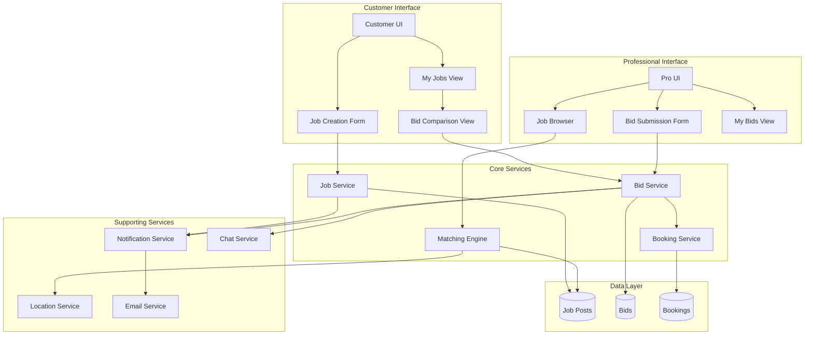
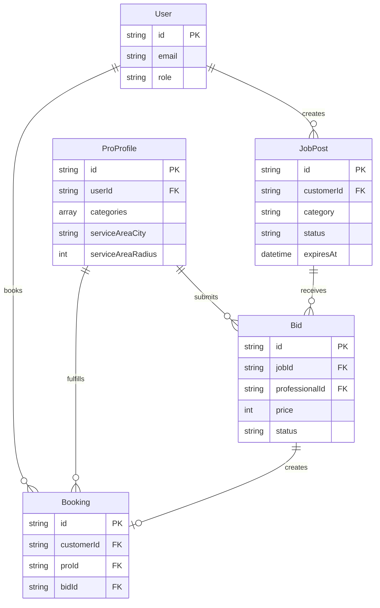

# Design Document: Job Posting & Bidding System

## Overview

The Job Posting & Bidding System introduces a reverse marketplace model to the Ozar platform, enabling customers to post job requests and receive competitive bids from qualified professionals. This system complements the existing direct booking flow by providing customers with price discovery and choice when they are uncertain which professional to hire.

The system consists of three primary workflows:
1. **Job Posting Flow**: Customers create detailed job posts with requirements, photos, and preferences
2. **Job Discovery & Bidding Flow**: Professionals discover relevant jobs and submit competitive proposals
3. **Bid Evaluation & Acceptance Flow**: Customers compare bids and accept the best proposal, automatically creating a booking

This design integrates seamlessly with existing Ozar systems including the booking engine, notification system, chat functionality, and location services.

## Architecture

### System Components



### Component Responsibilities

**Job Service**:
- Create, read, update, delete job posts
- Validate job post data
- Handle job expiration logic
- Manage job status transitions (OPEN → CLOSED/EXPIRED/CANCELLED)
- Enforce business rules (10 bid limit, 7-day expiration)

**Bid Service**:
- Create, read, update, delete bids
- Validate bid data
- Handle bid acceptance and rejection
- Create bookings from accepted bids
- Manage bid status transitions (PENDING → ACCEPTED/REJECTED/WITHDRAWN)

**Matching Engine**:
- Filter jobs by professional's service categories
- Filter jobs by professional's service area
- Exclude jobs with 10 bids
- Exclude jobs where professional already bid
- Return only OPEN jobs
- Support search and filtering

**Booking Service** (existing):
- Create bookings from accepted bids
- Handle booking lifecycle
- Integrate with payment system

**Notification Service** (existing):
- Send in-app notifications
- Trigger email notifications
- Handle notification preferences

**Chat Service** (existing):
- Enable communication between customers and bidding professionals
- Create conversation threads linked to jobs

**Location Service** (existing):
- Validate locations
- Calculate distance between job location and professional service area
- Determine if job falls within service area

## Components and Interfaces

### API Endpoints

#### Job Post Endpoints

```typescript
// Create a new job post
POST /api/jobs
Request Body: CreateJobDto
Response: JobPost

// Get all jobs for current user (customer)
GET /api/jobs
Query: ?status=OPEN&page=1&limit=10
Response: PaginatedJobPosts

// Get single job post with bids
GET /api/jobs/:id
Response: JobPostWithBids

// Update job post (limited fields)
PATCH /api/jobs/:id
Request Body: UpdateJobDto
Response: JobPost

// Cancel job post
POST /api/jobs/:id/cancel
Response: JobPost

// Get available jobs for professional
GET /api/jobs/available
Query: ?category=PLUMBING&urgency=ASAP&page=1&limit=10
Response: PaginatedJobPosts
```

#### Bid Endpoints

```typescript
// Submit a bid on a job
POST /api/bids
Request Body: CreateBidDto
Response: Bid

// Get all bids for current user (professional)
GET /api/bids
Query: ?status=PENDING&page=1&limit=10
Response: PaginatedBids

// Get single bid
GET /api/bids/:id
Response: BidWithDetails

// Update bid (only PENDING bids)
PATCH /api/bids/:id
Request Body: UpdateBidDto
Response: Bid

// Withdraw bid
POST /api/bids/:id/withdraw
Response: Bid

// Accept bid (customer only)
POST /api/bids/:id/accept
Response: BidWithBooking

// Reject bid (customer only)
POST /api/bids/:id/reject
Response: Bid

// Get bids for a specific job (customer only)
GET /api/jobs/:jobId/bids
Response: Bid[]
```

### Data Transfer Objects

```typescript
// Job Post DTOs
interface CreateJobDto {
  title: string;                    // 10-100 chars
  description: string;              // 50-2000 chars
  categoryId: string;               // ServiceCategory enum
  location: {
    address: string;
    city: string;
    lat: number;
    lng: number;
  };
  urgency: 'ASAP' | 'THIS_WEEK' | 'FLEXIBLE';
  budgetMin?: number;               // Optional, must be < budgetMax
  budgetMax?: number;               // Optional
  photos?: string[];                // 0-10 image URLs
}

interface UpdateJobDto {
  description?: string;
  urgency?: 'ASAP' | 'THIS_WEEK' | 'FLEXIBLE';
  budgetMin?: number;
  budgetMax?: number;
  photos?: string[];
}

interface JobPost {
  id: string;
  customerId: string;
  title: string;
  description: string;
  category: ServiceCategory;
  location: Location;
  urgency: UrgencyLevel;
  budgetMin?: number;
  budgetMax?: number;
  photos: string[];
  status: JobStatus;
  bidCount: number;
  expiresAt: Date;
  createdAt: Date;
  updatedAt: Date;
}

interface JobPostWithBids extends JobPost {
  bids: Bid[];
  customer: CustomerSummary;
}

// Bid DTOs
interface CreateBidDto {
  jobId: string;
  price: number;                    // > 0
  estimatedHours: number;           // > 0
  message: string;                  // 20-500 chars
  availabilityDate: Date;           // >= today
}

interface UpdateBidDto {
  price?: number;
  estimatedHours?: number;
  message?: string;
  availabilityDate?: Date;
}

interface Bid {
  id: string;
  jobId: string;
  professionalId: string;
  price: number;
  estimatedHours: number;
  message: string;
  availabilityDate: Date;
  status: BidStatus;
  createdAt: Date;
  updatedAt: Date;
}

interface BidWithDetails extends Bid {
  job: JobPost;
  professional: ProfessionalSummary;
}

interface BidWithBooking extends Bid {
  booking: Booking;
}

// Supporting Types
interface Location {
  address: string;
  city: string;
  lat: number;
  lng: number;
}

interface CustomerSummary {
  id: string;
  firstName: string;
  lastName: string;
  avatar?: string;
}

interface ProfessionalSummary {
  id: string;
  userId: string;
  businessName?: string;
  firstName: string;
  lastName: string;
  avatar?: string;
  rating: number;
  reviewCount: number;
  jobsCompleted: number;
  verificationStatus: VerificationStatus;
}

interface PaginatedJobPosts {
  data: JobPost[];
  pagination: {
    page: number;
    limit: number;
    total: number;
    totalPages: number;
  };
}

interface PaginatedBids {
  data: BidWithDetails[];
  pagination: {
    page: number;
    limit: number;
    total: number;
    totalPages: number;
  };
}
```

### Service Interfaces

```typescript
// Job Service Interface
interface IJobService {
  create(customerId: string, dto: CreateJobDto): Promise<JobPost>;
  findAll(customerId: string, filters: JobFilters): Promise<PaginatedJobPosts>;
  findOne(id: string, userId: string): Promise<JobPostWithBids>;
  update(id: string, customerId: string, dto: UpdateJobDto): Promise<JobPost>;
  cancel(id: string, customerId: string): Promise<JobPost>;
  findAvailable(proId: string, filters: JobFilters): Promise<PaginatedJobPosts>;
  expireJobs(): Promise<void>;  // Cron job
}

// Bid Service Interface
interface IBidService {
  create(professionalId: string, dto: CreateBidDto): Promise<Bid>;
  findAll(professionalId: string, filters: BidFilters): Promise<PaginatedBids>;
  findOne(id: string, userId: string): Promise<BidWithDetails>;
  update(id: string, professionalId: string, dto: UpdateBidDto): Promise<Bid>;
  withdraw(id: string, professionalId: string): Promise<Bid>;
  accept(id: string, customerId: string): Promise<BidWithBooking>;
  reject(id: string, customerId: string): Promise<Bid>;
  findByJob(jobId: string, customerId: string): Promise<Bid[]>;
}

// Matching Engine Interface
interface IMatchingEngine {
  findMatchingJobs(proId: string, filters: JobFilters): Promise<JobPost[]>;
  canProfessionalBid(proId: string, jobId: string): Promise<boolean>;
  isJobInServiceArea(jobLocation: Location, proId: string): Promise<boolean>;
}
```

## Data Models

### Database Schema Extensions

The system extends the existing Prisma schema with two new models:

```prisma
enum JobStatus {
  OPEN
  CLOSED
  EXPIRED
  CANCELLED
}

enum BidStatus {
  PENDING
  ACCEPTED
  REJECTED
  WITHDRAWN
}

enum UrgencyLevel {
  ASAP
  THIS_WEEK
  FLEXIBLE
}

model JobPost {
  id          String        @id @default(cuid())
  customerId  String
  title       String
  description String
  category    ServiceCategory
  locationAddr String
  locationCity String
  locationLat  Float
  locationLng  Float
  urgency     UrgencyLevel
  budgetMin   Int?
  budgetMax   Int?
  photos      String[]      @default([])
  status      JobStatus     @default(OPEN)
  expiresAt   DateTime
  createdAt   DateTime      @default(now())
  updatedAt   DateTime      @updatedAt

  // Relations
  customer User @relation("CustomerJobPosts", fields: [customerId], references: [id], onDelete: Cascade)
  bids     Bid[]

  @@index([customerId])
  @@index([category])
  @@index([status])
  @@index([expiresAt])
  @@index([locationLat, locationLng])
  @@map("job_posts")
}

model Bid {
  id               String    @id @default(cuid())
  jobId            String
  professionalId   String
  price            Int
  estimatedHours   Int
  message          String
  availabilityDate DateTime
  status           BidStatus @default(PENDING)
  createdAt        DateTime  @default(now())
  updatedAt        DateTime  @updatedAt

  // Relations
  job          JobPost    @relation(fields: [jobId], references: [id], onDelete: Cascade)
  professional ProProfile @relation(fields: [professionalId], references: [id], onDelete: Cascade)
  booking      Booking?   @relation("BidBooking")

  @@unique([jobId, professionalId])
  @@index([jobId])
  @@index([professionalId])
  @@index([status])
  @@map("bids")
}

// Extend existing User model
model User {
  // ... existing fields ...
  jobPosts JobPost[] @relation("CustomerJobPosts")
}

// Extend existing ProProfile model
model ProProfile {
  // ... existing fields ...
  bids Bid[]
}

// Extend existing Booking model
model Booking {
  // ... existing fields ...
  bidId String? @unique
  bid   Bid?    @relation("BidBooking", fields: [bidId], references: [id])
}

// Extend NotificationType enum
enum NotificationType {
  // ... existing types ...
  JOB_POSTED
  BID_RECEIVED
  BID_ACCEPTED
  BID_REJECTED
  JOB_EXPIRING_SOON
  JOB_EXPIRED
}
```

### Data Relationships



### Data Validation Rules

**JobPost Validation**:
- `title`: 10-100 characters, required
- `description`: 50-2000 characters, required
- `category`: Must be valid ServiceCategory enum value
- `location`: All fields required (address, city, lat, lng)
- `urgency`: Must be ASAP, THIS_WEEK, or FLEXIBLE
- `budgetMin`: If provided, must be > 0 and < budgetMax
- `budgetMax`: If provided, must be > budgetMin
- `photos`: Maximum 10 images, each must be valid URL
- `expiresAt`: Automatically set to createdAt + 7 days
- `status`: Defaults to OPEN

**Bid Validation**:
- `jobId`: Must reference existing JobPost with status OPEN
- `professionalId`: Must reference existing ProProfile
- `price`: Must be > 0
- `estimatedHours`: Must be > 0
- `message`: 20-500 characters, required
- `availabilityDate`: Must be >= today
- `status`: Defaults to PENDING
- Unique constraint on (jobId, professionalId) - one bid per pro per job

### Business Rule Enforcement

**Job Post Rules**:
1. Only customers can create job posts
2. Job posts automatically expire after 7 days if status is OPEN
3. Job posts with status CLOSED, EXPIRED, or CANCELLED cannot receive new bids
4. Customers can only cancel jobs with status OPEN
5. Job status changes to CLOSED when a bid is accepted

**Bid Rules**:
1. Maximum 10 bids per job post
2. Professionals can only bid on jobs matching their service categories
3. Professionals can only bid on jobs within their service area
4. Professionals cannot submit multiple bids on the same job
5. Only PENDING bids can be edited or withdrawn
6. Only PENDING bids can be accepted or rejected
7. When a bid is accepted, all other bids on that job are automatically rejected

**Booking Creation Rules**:
1. When a bid is accepted, automatically create a booking with:
   - Customer from job post
   - Professional from bid
   - Service details from job post
   - Price from accepted bid
   - Scheduled date from bid's availability date
   - Description from job post
   - Photos from job post
   - Location from job post


## Correctness Properties

A property is a characteristic or behavior that should hold true across all valid executions of a system—essentially, a formal statement about what the system should do. Properties serve as the bridge between human-readable specifications and machine-verifiable correctness guarantees.

### Property 1: Job Post Input Validation

*For any* job post creation request, the system should accept it if and only if: title is 10-100 characters, description is 50-2000 characters, category is a valid ServiceCategory enum, location contains all required fields (address, city, lat, lng), urgency is one of (ASAP, THIS_WEEK, FLEXIBLE), and if budget is provided then budgetMin < budgetMax.

**Validates: Requirements 1.1, 1.2, 1.3, 1.4, 1.5, 1.6**

### Property 2: Photo Upload Limits

*For any* job post with photos, the system should accept between 0 and 10 images, and reject requests with more than 10 images.

**Validates: Requirements 1.7**

### Property 3: Job Post Initialization

*For any* successfully created job post, the system should set status to OPEN, expiresAt to createdAt + 7 days, and return a complete job post object with generated ID and timestamps.

**Validates: Requirements 1.8, 1.9, 1.10**

### Property 4: Job Post Retrieval and Ordering

*For any* customer requesting their job posts, the system should return all jobs where customerId matches the requesting user, ordered by createdAt descending.

**Validates: Requirements 2.1**

### Property 5: Job Post with Bids

*For any* job post that has received bids, viewing the job should return the job data along with all associated bids.

**Validates: Requirements 2.2**

### Property 6: Job Cancellation State Transition

*For any* job post with status OPEN, cancelling it should change the status to CANCELLED. For any job post with status CLOSED, EXPIRED, or CANCELLED, attempting to cancel should be rejected.

**Validates: Requirements 2.3, 2.4**

### Property 7: Job Expiration

*For any* job post with status OPEN where current time >= expiresAt, the system should automatically change status to EXPIRED and create a notification for the customer.

**Validates: Requirements 2.5, 2.6**

### Property 8: Job Details Response Completeness

*For any* job post, viewing its details should return status, bidCount (number of associated bids), and daysRemaining (calculated from expiresAt).

**Validates: Requirements 2.7**

### Property 9: Job Matching by Category

*For any* professional with service categories C, browsing available jobs should return only jobs where job.category is in C.

**Validates: Requirements 3.1**

### Property 10: Job Matching by Service Area

*For any* professional with service area defined by (city, radius), browsing available jobs should return only jobs where the distance between job.location and professional.location is <= radius.

**Validates: Requirements 3.2**

### Property 11: Job Matching by Status and Bid Count

*For any* professional browsing jobs, the system should return only jobs where status = OPEN, bidCount < 10, and the professional has not already submitted a bid on that job.

**Validates: Requirements 3.3, 3.4, 3.5**

### Property 12: Job Listing Order

*For any* list of jobs returned to a professional, the jobs should be ordered by createdAt descending (newest first).

**Validates: Requirements 3.6**

### Property 13: Job Details Response Structure

*For any* job post viewed by a professional, the response should include title, description, category, location, urgency, budgetMin, budgetMax, photos, and bidCount.

**Validates: Requirements 3.7**

### Property 14: Bid Input Validation

*For any* bid submission request, the system should accept it if and only if: price > 0, estimatedHours > 0, message is 20-500 characters, and availabilityDate >= today.

**Validates: Requirements 4.1, 4.2, 4.3, 4.4**

### Property 15: Successful Bid Creation

*For any* valid bid submission on a job with status OPEN and bidCount < 10 where the professional has not already bid, the system should create the bid with status PENDING, store all bid data, and notify the customer.

**Validates: Requirements 4.5, 4.9, 4.10**

### Property 16: Bid Rejection Rules

*For any* bid submission, the system should reject it if: the job has 10 existing bids, OR the job status is not OPEN, OR the professional has already submitted a bid on that job.

**Validates: Requirements 4.6, 4.7, 4.8**

### Property 17: Bid Update Rules

*For any* bid with status PENDING, updating it should apply the new values for price, estimatedHours, message, and availabilityDate. For any bid with status ACCEPTED, REJECTED, or WITHDRAWN, attempting to update should be rejected.

**Validates: Requirements 5.1, 5.2**

### Property 18: Bid Withdrawal Rules

*For any* bid with status PENDING, withdrawing it should change status to WITHDRAWN. For any bid with status ACCEPTED, REJECTED, or WITHDRAWN, attempting to withdraw should be rejected.

**Validates: Requirements 5.3, 5.4**

### Property 19: Professional Bid Retrieval

*For any* professional requesting their bids, the system should return all bids where professionalId matches the requesting user, including job details, bid status, submission date, and job expiration date.

**Validates: Requirements 5.5, 5.6**

### Property 20: Bid Acceptance Cascade

*For any* bid with status PENDING on a job with status OPEN, accepting it should: (1) change bid status to ACCEPTED, (2) change job status to CLOSED, (3) create a booking with data from the bid and job, (4) set booking.scheduledFor to bid.availabilityDate, (5) change all other PENDING bids on that job to REJECTED, (6) notify the winning professional, and (7) notify all rejected professionals.

**Validates: Requirements 6.1, 6.2, 6.3, 6.4, 6.5, 6.6, 6.7**

### Property 21: Bid Acceptance Rejection Rules

*For any* bid on a job with status CLOSED, EXPIRED, or CANCELLED, attempting to accept the bid should be rejected.

**Validates: Requirements 6.8**

### Property 22: Booking Data Mapping

*For any* booking created from an accepted bid, the booking should include the job's description and photos in its details.

**Validates: Requirements 6.9**

### Property 23: Bid Comparison View

*For any* job post, viewing its bids should return all bids with status PENDING ordered by price ascending, with each bid including professional name, rating, jobsCompleted, price, estimatedHours, message, availabilityDate, profile photo, and verification status.

**Validates: Requirements 7.1, 7.2, 7.3**

### Property 24: Bid Highlighting

*For any* set of bids on a job, the system should identify and mark the bid with the lowest price and the bid with the earliest availabilityDate.

**Validates: Requirements 7.4, 7.5**

### Property 25: Bid Rejection

*For any* bid with status PENDING, rejecting it should change status to REJECTED and notify the professional. For any bid with status ACCEPTED, attempting to reject should be rejected. Rejecting a bid should not change the job status if the job is still OPEN.

**Validates: Requirements 8.1, 8.2, 8.3, 8.4**

### Property 26: Chat Enablement

*For any* bid submission, the system should create or enable a conversation between the customer and the professional.

**Validates: Requirements 9.1**

### Property 27: Job Posting Notifications

*For any* newly created job post, the system should notify all professionals where: (1) the job category matches at least one of their service categories, AND (2) the job location falls within their service area. The notification should include job title, category, location, and urgency.

**Validates: Requirements 10.1, 10.7**

### Property 28: Job Expiration Warning

*For any* job post with status OPEN where (expiresAt - current time) <= 24 hours, the system should notify the customer.

**Validates: Requirements 10.6**

### Property 29: Cascade Delete for Jobs

*For any* job post that is deleted, the system should automatically delete all associated bids.

**Validates: Requirements 11.3**

### Property 30: Cascade Delete for Professionals

*For any* professional (ProProfile) that is deleted, the system should automatically delete all their bids.

**Validates: Requirements 11.4**

### Property 31: Cascade Delete for Customers

*For any* customer (User) that is deleted, the system should automatically delete all their job posts and all bids associated with those job posts.

**Validates: Requirements 11.5**

### Property 32: Job Filtering by Category

*For any* professional filtering jobs by a specific category, the system should return only jobs where job.category equals the filter category.

**Validates: Requirements 13.1**

### Property 33: Job Filtering by Urgency

*For any* professional filtering jobs by a specific urgency level, the system should return only jobs where job.urgency equals the filter urgency.

**Validates: Requirements 13.2**

### Property 34: Job Filtering by Budget Range

*For any* professional filtering jobs by budget range [filterMin, filterMax], the system should return only jobs where the job's budget range [budgetMin, budgetMax] overlaps with the filter range (i.e., budgetMax >= filterMin AND budgetMin <= filterMax).

**Validates: Requirements 13.3**

### Property 35: Job Sorting

*For any* professional sorting jobs by a field (createdAt, urgency, or budget), the system should return jobs ordered by that field in the specified direction (ascending or descending).

**Validates: Requirements 13.4**

### Property 36: Job Keyword Search

*For any* professional searching jobs by keyword K, the system should return only jobs where K appears in the job title OR job description (case-insensitive).

**Validates: Requirements 13.5**

### Property 37: Bid Statistics Calculation

*For any* professional viewing their bid statistics, the system should calculate: (1) totalBids = count of all bids, (2) acceptedBids = count of bids with status ACCEPTED, (3) acceptanceRate = (acceptedBids / totalBids) * 100, (4) averageBidAmount = sum of all bid prices / totalBids, and (5) totalEarnings = sum of prices for bids with status ACCEPTED.

**Validates: Requirements 14.1, 14.2, 14.3, 14.4, 14.5**

### Property 38: Available Jobs Badge Count

*For any* professional viewing the mobile app, the badge count should equal the number of jobs matching their categories and service area with status OPEN and bidCount < 10 where they haven't already bid.

**Validates: Requirements 15.4**

## Error Handling

### Error Categories

**Validation Errors (400 Bad Request)**:
- Invalid input data (title too short/long, price <= 0, etc.)
- Invalid enum values (category, urgency, status)
- Budget range validation (min >= max)
- Date validation (availability date in past)
- Photo count exceeds limit

**Authorization Errors (403 Forbidden)**:
- Customer attempting to bid on jobs
- Professional attempting to create job posts
- User attempting to access another user's resources
- Professional attempting to accept/reject bids

**Not Found Errors (404 Not Found)**:
- Job post not found
- Bid not found
- Professional profile not found
- Service not found

**Conflict Errors (409 Conflict)**:
- Attempting to bid twice on same job
- Attempting to accept bid on closed job
- Attempting to edit accepted/rejected bid
- Job already has 10 bids
- Job status doesn't allow operation

**Business Logic Errors (422 Unprocessable Entity)**:
- Professional bidding outside service area
- Professional bidding outside service categories
- Cancelling non-OPEN job
- Accepting non-PENDING bid

### Error Response Format

All errors follow a consistent format:

```typescript
interface ErrorResponse {
  statusCode: number;
  message: string;
  error: string;
  details?: any;
}
```

### Error Recovery

**Job Expiration Recovery**:
- Scheduled cron job runs every hour to expire jobs
- If cron fails, jobs are checked on-demand when accessed
- Expired jobs are marked EXPIRED and notifications sent

**Notification Failures**:
- Notification failures are logged but don't block operations
- Failed notifications are retried up to 3 times
- Email failures don't prevent in-app notifications

**Booking Creation Failures**:
- If booking creation fails during bid acceptance, the transaction is rolled back
- Bid status remains PENDING
- Job status remains OPEN
- User is notified of the failure

**Cascade Delete Failures**:
- Database foreign key constraints ensure referential integrity
- Cascade deletes are handled at database level
- If cascade fails, parent delete is rolled back

## Testing Strategy

### Dual Testing Approach

The Job Posting & Bidding System requires both unit tests and property-based tests for comprehensive coverage:

**Unit Tests**: Focus on specific examples, edge cases, and integration points
- Specific job post creation scenarios
- Specific bid acceptance workflows
- Error handling for known edge cases
- Integration with booking service
- Integration with notification service
- API endpoint request/response validation

**Property-Based Tests**: Verify universal properties across all inputs
- Input validation properties (Properties 1, 2, 14)
- State transition properties (Properties 6, 17, 18, 20, 25)
- Filtering and matching properties (Properties 9, 10, 11, 32-36)
- Data integrity properties (Properties 29-31)
- Calculation properties (Property 37)

### Property-Based Testing Configuration

**Testing Library**: Use `fast-check` for TypeScript/JavaScript property-based testing

**Test Configuration**:
- Minimum 100 iterations per property test
- Each property test must reference its design document property
- Tag format: `Feature: job-posting-bidding-system, Property {number}: {property_text}`

**Example Property Test Structure**:

```typescript
import fc from 'fast-check';

describe('Feature: job-posting-bidding-system, Property 1: Job Post Input Validation', () => {
  it('should accept valid job posts and reject invalid ones', async () => {
    await fc.assert(
      fc.asyncProperty(
        fc.record({
          title: fc.string({ minLength: 10, maxLength: 100 }),
          description: fc.string({ minLength: 50, maxLength: 2000 }),
          category: fc.constantFrom(...Object.values(ServiceCategory)),
          location: fc.record({
            address: fc.string({ minLength: 1 }),
            city: fc.string({ minLength: 1 }),
            lat: fc.double({ min: -90, max: 90 }),
            lng: fc.double({ min: -180, max: 180 }),
          }),
          urgency: fc.constantFrom('ASAP', 'THIS_WEEK', 'FLEXIBLE'),
          budgetMin: fc.option(fc.integer({ min: 1, max: 10000 })),
          budgetMax: fc.option(fc.integer({ min: 1, max: 10000 })),
        }),
        async (jobData) => {
          // Ensure budgetMin < budgetMax if both provided
          if (jobData.budgetMin && jobData.budgetMax) {
            if (jobData.budgetMin >= jobData.budgetMax) {
              // Should be rejected
              await expect(jobService.create(customerId, jobData)).rejects.toThrow();
            } else {
              // Should be accepted
              const result = await jobService.create(customerId, jobData);
              expect(result).toBeDefined();
              expect(result.title).toBe(jobData.title);
            }
          }
        }
      ),
      { numRuns: 100 }
    );
  });
});
```

### Test Coverage Goals

- **Unit Test Coverage**: Minimum 80% code coverage
- **Property Test Coverage**: All 38 correctness properties implemented
- **Integration Test Coverage**: All API endpoints tested
- **E2E Test Coverage**: Complete user workflows tested (job posting → bidding → acceptance → booking)

### Testing Priorities

**High Priority** (Must test before deployment):
1. Bid acceptance and booking creation (Property 20, 22)
2. Job matching and filtering (Properties 9, 10, 11)
3. Input validation (Properties 1, 2, 14)
4. State transitions (Properties 6, 17, 18, 20, 25)
5. Notification creation (Properties 15, 20, 25, 27)

**Medium Priority** (Should test):
1. Cascade deletes (Properties 29, 30, 31)
2. Statistics calculations (Property 37)
3. Search and filtering (Properties 32-36)
4. Job expiration (Property 7)

**Low Priority** (Nice to have):
1. UI-specific properties (Property 24, 38)
2. Response structure validation (Properties 8, 13, 19, 23)

### Continuous Testing

**Pre-commit Hooks**:
- Run unit tests
- Run linting and type checking

**CI/CD Pipeline**:
- Run all unit tests
- Run all property-based tests
- Run integration tests
- Generate coverage reports
- Block merge if coverage drops below threshold

**Scheduled Tests**:
- Run full test suite nightly
- Run property tests with increased iterations (1000+) weekly
- Run performance tests weekly
